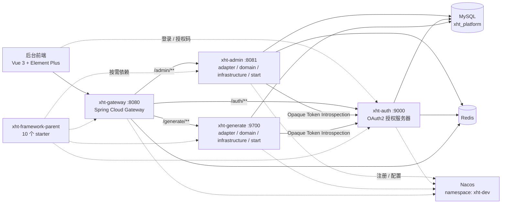

# xht-platform

<p>
  
  
  
  
  
</p>

> 基于 Spring Cloud Alibaba 的企业级微服务底座：分布式认证中心 + 网关 + 分层后台管理 + 代码生成。

| 仓库 | 地址 |
| --- | --- |
| 后端（本仓库） | https://gitee.com/xhtrepo/xht-platform |
| 后台前端 | https://gitee.com/xhtrepo/xht-platform-admin |

## 项目介绍

xht-platform 是一个基于 Spring Cloud Alibaba 的微服务架构平台，专为企业级应用开发设计。平台提供完整的认证授权体系、网关路由、系统管理等核心功能，帮助开发团队快速构建安全、可靠、可扩展的微服务应用。

平台由四个可独立部署的服务与两套公共依赖组成：

- **xht-auth**：OAuth2 授权服务器（授权码 / 密码 / 手机号 / 扫码 / 第三方登录），签发 JWT 或 Opaque Token；
- **xht-gateway**：Spring Cloud Gateway 统一入口，负责路由、跨域、鉴权与链路透传；
- **xht-admin**：后台管理服务，覆盖用户、角色、菜单、部门、字典、通知、文件等基础能力，按 `adapter / domain / infrastructure / start` 四层组织；
- **xht-generate**：代码生成服务，按数据表生成后端分层代码，同样采用四层结构；
- **xht-framework-parent**：10 个自研 starter + 核心库 + 依赖 BOM，业务服务按需引入；
- **xht-platform-common / xht-platform-client**：跨服务契约（Feign 接口、公共 DTO、消息/字典/日志 SPI）与客户端自动装配。

## 功能特性

**认证中心（xht-auth）**

- OAuth2 授权服务器：授权码、密码、手机号、扫码登录，OIDC 用户信息端点
- JWT / Opaque Token 双形态，Redis 存储授权信息，支持令牌撤销
- 第三方登录（Gitee 等）与授权确认页、Remember-Me、单用户会话数限制
- 图形验证码（算术验证码）、登录日志异步落库

**网关（xht-gateway）**

- 基于服务发现的动态路由：`/auth/**`、`/admin/**`、`/generate/**`（`StripPrefix=1`）
- 全局 CORS、鉴权入口、响应式安全配置
- 与 Spring Session + Redis 协同的会话管理

**后台管理（xht-admin）**

- 用户 / 角色 / 菜单 / 部门 / 岗位、角色菜单绑定、用户角色绑定
- 数据字典与字典项、行政区划（树形 + 经纬度）
- 通知公告（草稿 / 定时发布 / 置顶 / 下架）、站内信（已读、置顶、删除）
- 操作日志（`@BLog`）与登录日志、OAuth2 客户端管理
- 文件上传/下载/预览，本地与可扩展存储，孤儿文件定时清理

**代码生成（xht-generate）**

- 多数据源接入、表结构与字段元数据同步
- 模板与模板分组管理、数据库类型映射、代码在线预览与打包下载

**框架组件（xht-framework-parent：10 个 starter + 核心库 + 依赖 BOM）**

| Starter | 能力 |
| --- | --- |
| `xht-framework-core` | 统一响应 `R`、异常体系、通用 DTO、校验分组、Jackson、文件存储、工具类（非 starter） |
| `xht-framework-dependencies` | 纯 BOM，统一 Spring / 三方 / 自研模块版本 |
| `xht-cache-spring-boot-starter` | RedisTemplate、CacheManager、`RedisRepository` 仓储封装 |
| `xht-web-spring-boot-starter` | 全局异常处理、CORS、XSS 过滤、TraceId、接口加解密 |
| `xht-mybatis-plus-spring-boot-starter` | 分页/乐观锁/数据权限插件、字段自动填充、逻辑删除、Repository 基类 |
| `xht-security-spring-boot-starter` | `@IgnoreAuth` 白名单、密码编码器、安全异常处理 |
| `xht-resource-server-spring-boot-starter` | OAuth2 资源服务器与 `@CheckMenu` / `@CheckRole` / `@IsAdmin` |
| `xht-openfeign-spring-boot-starter` | Feign 内部认证头、Token 透传、链路日志拦截 |
| `xht-log-spring-boot-starter` | `@BLog` 操作日志、方法耗时统计 |
| `xht-sms-spring-boot-starter` | 短信验证码生成、手机号格式校验 |
| `xht-swagger-spring-boot-starter` | Knife4j / OpenAPI 文档（需 `@EnableCustomSwagger` 开启） |
| `xht-spring-cloud-starter` | Nacos 注册/配置、LoadBalancer、OpenFeign、`@LoadBalanced RestClient` |

## 软件架构



**分层约定**：业务服务内部统一采用四层，依赖方向单向向下，禁止反向引用。

```
adapter          控制器、内部 Feign 服务端（对外适配层）
  ↓
domain           领域模型（form / query / response / vo / enums）+ Service 接口
  ↑
infrastructure   Service 实现、DAO / Mapper / Entity、MapStruct Converter
  ↑
start            启动类与配置，聚合 adapter + infrastructure
```

- `adapter → domain`，`infrastructure → domain`，`start → adapter + infrastructure`；
- Service **接口**在 `domain`，**实现在 `infrastructure`**（保留包名相同，不加 `impl` 子包）；
- 实体不出 `infrastructure`，对外只暴露 `response` / `vo`，由 Converter 完成转换。

## 技术栈

| 分类 | 选型 |
| --- | --- |
| 运行环境 | Java 17、Maven 3.8+ |
| 核心框架 | Spring Boot 3.5.15、Spring Cloud 2025.0.3、Spring Cloud Alibaba 2025.0.0.0 |
| 认证授权 | Spring Security、OAuth2 Authorization Server、OIDC、JWT / Opaque Token |
| 服务治理 | Nacos（注册 + 配置）、Spring Cloud LoadBalancer、OpenFeign |
| API 网关 | Spring Cloud Gateway（WebFlux） |
| 数据访问 | MyBatis-Plus 3.5.16、MySQL 8+（驱动 9.4.0） |
| 缓存 / 会话 | Redis 7+、Spring Session |
| 对象转换 | MapStruct 1.6.3、Lombok 1.18.36 |
| 工具库 | Hutool 5.8.42、Commons Lang3、Commons IO |
| API 文档 | SpringDoc OpenAPI、Knife4j 4.5.0 |
| 日志 | SLF4J、Logback |
| 前端 | Vue 3、Element Plus（独立仓库） |

## 快速开始

### 1. 环境要求

| 软件 | 版本 | 说明 |
| --- | --- | --- |
| JDK | 17 | 编译目标为 17，不支持 8/11 |
| Maven | 3.8+ | 多模块聚合构建 |
| MySQL | 8+ | 库名 `xht_platform`，字符集 `utf8mb4` |
| Redis | 7+ | 令牌、会话、字典缓存 |
| Nacos | 3.x | 注册中心 + 配置中心，命名空间 `xht-dev` |
| Node.js | 20+ | 仅前端需要 |

### 2. 拉取代码

```shell
git clone https://gitee.com/xhtrepo/xht-platform.git
```

### 3. 初始化数据库

按顺序执行 `doc/sql` 目录下的脚本：

| 顺序 | 脚本 | 作用 |
| --- | --- | --- |
| 1 | `doc/sql/xht_nacos.sql` | Nacos 配置库 |
| 2 | `doc/sql/xht-platform-init.sql` | 平台初始化数据；**建表 DDL 在 `xht-platform.sql` 中** |
| 3 | `doc/sql/xht-generate-init.sql` | 代码生成模块表与模板数据 |

> 全量建表脚本为 `xht-platform.sql`（含 `b_log` 等表结构），按需取用，避免与初始化脚本重复执行；已有数据库升级请执行 `xht-platform-upgrade.sql`。

### 4. 准备 Nacos

- 启动 Nacos，创建命名空间 `xht-dev`（测试/生产对应 `xht-test` / `xht-prod`）；
- 配置分组使用 `XHT_CLOUD_GROUP`，格式 `yml`，dataId 取各服务的 `spring.application.name`：`xht-auth.yml`、`xht-admin.yml`、`xht-gateway.yml`、`xht-generate.yml`；当前阶段以本地配置文件为准，Nacos 配置可按需接入；
- Nacos 地址、账号、命名空间等通过 Maven profile 注入（见「配置说明」）。

### 5. 启动服务

```shell
# 首次构建：把框架与公共模块安装到本地仓库
mvn -DskipTests clean install

# 1) 认证中心（其它服务依赖其 introspection 端点）
mvn -pl xht-auth spring-boot:run

# 2) 后台管理
mvn -pl xht-admin/xht-admin-start spring-boot:run

# 3) 代码生成
mvn -pl xht-generate/xht-generate-start spring-boot:run

# 4) 网关（最后启动）
mvn -pl xht-gateway spring-boot:run
```

推荐直接在 IDE 中运行各模块启动类（需先执行一次 `mvn -DskipTests install` 以解析内部依赖）：`AuthApplication`、`AdminApplication`、`GenerateApplication`、`GatewayApplication`。

| 服务 | 启动类 | 端口 | 说明 |
| --- | --- | --- | --- |
| xht-auth | `com.xht.auth.AuthApplication` | 9000 | 必须先启动 |
| xht-admin | `com.xht.platform.AdminApplication` | 8081 | 后台管理接口 |
| xht-generate | `com.xht.platform.GenerateApplication` | 9700 | 代码生成接口 |
| xht-gateway | `com.xht.gateway.GatewayApplication` | 8080 | 统一入口 |

### 6. 配置 hosts

授权码模式与扫码登录依赖域名，本地需追加：

```
127.0.0.1  www.xht.com
127.0.0.1  www.xht.sso.com
```

### 7. 访问

- 接口文档：各服务启动后访问 `/swagger-ui.html`（集成 Knife4j 时为 `/doc.html`）；
- 网关入口：`http://localhost:8080/admin/**`、`http://localhost:8080/generate/**`、`http://localhost:8080/auth/**`；
- 网关已关闭 `discovery.locator`，按服务名直连的 `/xht-admin/**` 等路径不再可用；调试请走上面的显式前缀或直连服务端口（admin `8081`、auth `9000`、generate `9700`）；
- `/api/**` 为服务间内部接口，网关按**入站路径**判定并返回 404（含 `%252e%252e` 等编码变体），只能由 Feign 直连；受保护根路径见 `xht.gateway.internal-api.roots`（默认 `/api`，修改后需重启网关）；
- 认证中心：`http://www.xht.sso.com:9000`；
- 前端：克隆前端仓库后 `pnpm install && pnpm run dev`。

## 项目结构

```txt
xht-platform
├── doc                                  # 文档与脚本
│   ├── sql                              # 数据库初始化脚本
│   ├── 安装部署                          # 本地启动、常见问题、nginx 配置
│   ├── 开发规范和编码指南.md
│   └── 开发需求.md
├── xht-framework-parent                 # 框架父工程（12 个模块）
│   ├── xht-framework-dependencies               # 依赖版本 BOM（无源码）
│   ├── xht-framework-core                       # 核心库：R、异常、通用 DTO、工具类
│   ├── xht-cache-spring-boot-starter            # Redis 缓存
│   ├── xht-web-spring-boot-starter              # 全局异常、CORS、XSS、TraceId、加解密
│   ├── xht-mybatis-plus-spring-boot-starter     # 分页/乐观锁/数据权限/字段填充/逻辑删除
│   ├── xht-security-spring-boot-starter         # @IgnoreAuth、密码编码、安全异常
│   ├── xht-resource-server-spring-boot-starter  # 资源服务器、@CheckMenu/@CheckRole/@IsAdmin
│   ├── xht-openfeign-spring-boot-starter        # Feign 认证头与链路拦截
│   ├── xht-log-spring-boot-starter              # @BLog 操作日志、方法耗时
│   ├── xht-sms-spring-boot-starter              # 短信验证码、手机号校验
│   ├── xht-swagger-spring-boot-starter          # OpenAPI / Knife4j
│   └── xht-spring-cloud-starter                 # Nacos + LoadBalancer + OpenFeign（根包 com.xht.cloud）
├── xht-auth                             # 认证中心（OAuth2 授权服务器）
├── xht-gateway                          # 网关服务
├── xht-admin                            # 后台管理服务
│   ├── xht-admin-adapter                        # Controller、内部 Feign 服务端
│   ├── xht-admin-domain                         # form/query/response/vo、enums、Service 接口
│   ├── xht-admin-infrastructure                 # Service 实现、DAO/Mapper/Entity、Converter
│   └── xht-admin-start                          # 启动类、application.yml、logback
├── xht-generate                         # 代码生成服务
│   ├── xht-generate-adapter                     # Controller
│   ├── xht-generate-domain                      # 领域模型与 Service 接口
│   ├── xht-generate-infrastructure              # 实现、DAO、模板与数据库方言策略
│   └── xht-generate-start                       # 启动类与配置
├── xht-platform-common                  # 公共模块
│   ├── xht-admin-common                         # 后台公共：Feign 契约、字典/消息/日志 SPI、文件模型
│   └── xht-generate-common                      # 生成器常量与枚举
└── xht-platform-client                  # 服务间调用客户端（自动装配）
    ├── xht-platform-client-blog                 # 操作日志上报
    ├── xht-platform-client-dict                 # 字典查询
    └── xht-platform-client-message              # 站内信发送
```

> `xht-platform-common` 只放被共享的代码（契约、DTO、枚举、工具），`xht-platform-client` 只放让契约跑起来的自动装配。业务模块要用其它服务的能力时，加对应 `xht-platform-client-*` 依赖并注入门面（`ISysDictFactory`、`IMessagePublisher`），不需要写 `@EnableFeignClients`。详见 `doc/开发规范和编码指南.md` 第 2.6、2.7、6.2~6.4 节。

## 文档索引

| 文档 | 说明 |
| --- | --- |
| [本地启动](doc/安装部署/本地启动.md) | 环境准备、启动步骤、hosts、nginx 部署 |
| [常见问题](doc/安装部署/问题.md) | 启动与运行期问题排查 |
| [开发规范和编码指南](doc/开发规范和编码指南.md) | 项目概述、分层、命名、编码、接口、SQL、Git 全量规范 |
| [开发需求](doc/开发需求.md) | 需求清单与完成情况 |

## 配置说明

### Maven Profile

根 `pom.xml` 通过 profile 注入 Nacos 与日志参数，并在打包时替换 `application.yml` 中的 `@...@` 占位符：

| Profile | 激活 | 日志目录 | Nacos 命名空间 |
| --- | --- | --- | --- |
| `dev` | 默认 | `D:\logs` | `xht-dev` |
| `test` | 手动 `-P test` | `/home/xht-logs` | `xht-test` |
| `prod` | 手动 `-P prod` | `/home/xht-logs` | `xht-prod` |

可覆盖的属性：`nacos.discovery.address`、`nacos.config.address`、`nacos.username`、`nacos.password`、`nacos.namespace`、`nacos.group`、`log.file.path`。

### 关键业务配置（`xht.*`）

| 前缀 | 作用 |
| --- | --- |
| `xht.security.whitelist` | 免鉴权白名单，可自动补充 Swagger 与默认忽略地址 |
| `xht.security.header` | 内部调用认证头（`auth-key` / `auth-value`） |
| `xht.security.token.lightning-cache` | 令牌轻量缓存过期时间 |
| `xht.oauth2.*` | 授权服务器端点、登录页、客户端、授权类型密钥 |
| `xht.file.storage` / `xht.file.upload` | 文件存储方式、大小与后缀限制 |
| `xht.file.clean` | 孤儿文件清理 |
| `xht.blog.repository-type` | 操作日志落库方式：`default`（仅 debug 输出，**不落库**）、`feign`（上报 `xht-admin`）、`jdbc`（本地直写 `b_log`，目前仅 `xht-admin` 支持） |
| `xht.gateway.internal-api.roots` | 网关受保护的服务间内部接口根路径集合，默认 `["/api"]`，可配多个；按入站路径 + 命中路由的 `StripPrefix` 段数判定，需重启生效 |

## 常见问题

启动报错、Nacos 连接失败、授权码回调异常等，先查阅 [常见问题](doc/安装部署/问题.md)。

## 贡献指南

1. 从 `develop` 拉出 `feature/xxx` 或 `bugfix/xxx` 分支；
2. 编码前阅读 [开发规范和编码指南](doc/开发规范和编码指南.md)，确保分层、命名、响应体、异常处理符合约定；
3. 提交信息使用 `类型: 描述`（`feat` / `fix` / `refactor` / `docs` / `style` / `test` / `chore`）；
4. 提交 PR 前保证本地编译通过、自测覆盖改动点，并在描述中说明影响范围。

## 许可证

本项目基于 [Apache License 2.0](LICENSE) 开源。
